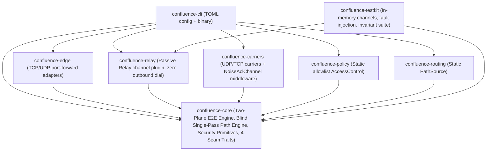
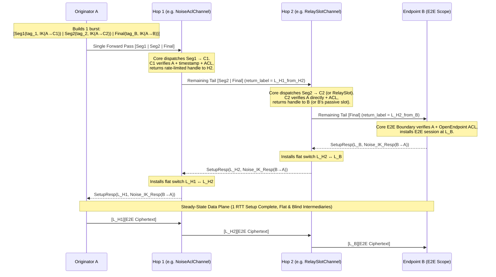

# Confluence Core — Implementation Plan (Milestone 1)

This plan translates the updated [DESIGN.md](DESIGN.md) into a concrete Rust implementation architecture for Milestone 1 while strictly upholding all nine Cleanroom Invariants.

---

## 1. Locked-In Design Decisions

| Dimension | Decision |
| :--- | :--- |
| **Language & Runtime** | Rust (`rustc 1.96.0`) + async `tokio`, structured as a Cargo workspace (library core + plugin crates + thin CLI binary). |
| **Extension Seams** | In-process Rust traits in `confluence-core`, with serializable control-plane request/response types so IPC/sidecar adapters can attach cleanly later without changing Core. |
| **Crypto & Replay** | Per-scope / per-channel X25519 keypairs (`PeerId = [u8; 32]`); `Noise_IK` (`Noise_IK_25519_ChaChaPoly_BLAKE2s` via `snow`); TAI64N 12-byte timestamps + per-peer replay cache for 0-RTT hop auth; stateless MAC2 cookie DoS protection under flood; 8-byte opaque `target_tag = BLAKE2s(static_pubkey)[..8]` for single-listener demux. |
| **Path Engine Model** | **Relay-agnostic, hop-ACL-agnostic, hop-crypto-agnostic.** Core dispatches each hop's opaque setup segment by `target_tag` to the targeted outbound channel plugin (`channel ↔ originator` direct auth), runs **single-pass 1-RTT pipelined chain setup** (0-RTT per hop, 1 RTT total end-to-end), and installs flat 4-byte datagram label switches or raw bidirectional stream splices. |
| **Composable Channel Plugins** | Vertical channel middleware: reusable `NoiseAclChannel<Inner>` wraps *any* carrier (`UdpChannel`, `TcpChannel`, etc.) to add `Noise_IK` + timestamp replay + MAC2 cookies + `AccessControl` + `GrantEnforcer`. Passive Relay (`confluence-relay`) is purely a channel plugin with zero outbound dialing, working uniformly for `A → R ← B` and `A → H₁ → R ← B` with direct `A ↔ R` auth. |
| **Stream Plane Model** | 1-to-1 stream splicing (no in-core stream mux). Intermediate hops splice raw bytes bidirectionally; E2E `A ↔ B` runs `Noise_IK(endpoint, cred)` + length-prefixed AEAD records. |
| **Datagram Plane Model** | One `Noise_IK` session per `(A, B, scope, endpoint)` — symmetric lifecycle with Stream Plane, single hot-path lookup (`HopLabel → session`), zero extra endpoint header bytes. |
| **Grant Enforcement** | Expiry timestamp + optional token-bucket bounds (`max_bytes_per_sec`, `max_datagrams_per_sec`) + `max_concurrent_streams`; local policy intersection (`IntersectAccessControl`, hard veto); in-band renewal + immediate local teardown on revocation. |
| **M1 Deliverable** | `confluence-core` + deterministic `confluence-testkit` + native UDP/TCP carriers, `NoiseAclChannel` middleware, `confluence-relay` passive relay plugin, static policy/routing, TCP/UDP port-forward edge adapters, and declarative TOML CLI demo. |

---

## 2. Cargo Workspace Layout

Dependency edges enforce the cleanroom boundary at compile time: **`confluence-core` never depends on any carrier, relay plugin, policy backend, routing engine, edge adapter, or CLI crate.**



### Crate Responsibilities

| Crate | Purpose |
| :--- | :--- |
| `confluence-core` | Two-plane E2E engine (Datagram & Stream), Trust Scopes, `EndpointRegistry`, ultra-thin blind single-pass Composable Path Engine (label switching & stream splicing), the 4 Seam traits, and reusable security/enforcement building blocks (`Noise_IK`, TAI64N replay window, MAC2 cookies, `IntersectAccessControl`, `GrantEnforcer`) exported for channel plugins. |
| `confluence-carriers` | Minimal native `UdpDatagramChannel` and `TcpStreamChannel` (pure connectivity), plus the composable `NoiseAclChannel<Inner>` middleware (Seam 1 vertical wrapper adding `channel ↔ originator` auth, `AccessControl`, and `GrantEnforcer` to any carrier). |
| `confluence-relay` | Standalone Passive Relay channel plugin (`RelayDatagramChannel` / `RelayStreamChannel` + slot registry composed with `NoiseAclChannel`). Structurally incapable of outbound dialing (zero dialer/transit code); works both as a 1-hop channel (`A → R ← B`) and at the tail of a multi-hop chain (`A → H₁ → R ← B`) with direct `A ↔ R` auth. |
| `confluence-testkit` | Deterministic in-memory `DatagramChannel` & `StreamChannel` hubs with latency, drop, reorder, MTU enforcement, and link-failure injection; verifies all 9 Cleanroom Invariants deterministically. |
| `confluence-policy` | Static TOML-driven allowlist & per-peer/per-action `Grant` rules implementing Seam 3 (with live local revocation triggers). |
| `confluence-routing` | Static TOML-driven explicit path table implementing Seam 2. |
| `confluence-edge` | Local TCP and UDP port-forwarders implementing Seam 4. |
| `confluence-cli` | Thin executable loading a node's TOML config (keys, Trust Scopes, carriers, ACL-wrapped egress channels, relay channels, endpoints, routes, edge bindings) to run real Direct, Passive Relay, and Multi-Hop topologies. |

---

## 3. Core Seam Trait Contracts (`confluence-core::seams`)

### Seam 1: Composable Channels (`seams::channel`)
Strict plane separation is enforced in the Rust type system. Channels divide cleanly into **Transport Carriers** (pure connectivity) and **Forwardable Channels** (outbound targets mounted by `target_tag` that accept `channel ↔ originator` setup handshakes):

- `ChannelCaps`: `{ plane: Plane, reliable_underlay: bool, ordered_underlay: bool, max_payload_bytes: Option<usize> }`
- `ChannelHealth`: `Healthy | Degraded(String) | Closed(String)`
- **Raw Carriers:**
  - `DatagramChannel`: `id()`, `caps()`, `send_to(addr, payload)`, `recv_from(buf)`, `health()`
  - `StreamChannel`: `id()`, `caps()`, `open(addr) -> BoxedAsyncStream`, `accept() -> (BoxedAsyncStream, addr)`, `health()`
- **Forwardable Channel Targets (mounted on a node by 8-byte `target_tag`):**
  - `DatagramForwardChannel`:
    - `target_tag() -> TargetTag`
    - `caps() -> ChannelCaps`
    - `handle_setup(&self, source_addr: &ChannelAddr, setup_payload: &[u8]) -> SetupOutcome<BoxedDatagramForwardHandle>`
  - `StreamForwardChannel`:
    - `target_tag() -> TargetTag`
    - `caps() -> ChannelCaps`
    - `handle_setup(&self, source_addr: &ChannelAddr, setup_payload: &[u8]) -> SetupOutcome<BoxedAsyncStream>`
  - `SetupOutcome<H>`:
    - `Accept { handle: H, reply_hint: Option<Vec<u8>> }` (where `handle` already enforces the channel's `Grant` rate limits, expiry, and revocation teardown!)
    - `Challenge(Vec<u8>)` (e.g., stateless MAC2 cookie reply under DoS)
    - `Reject(String)`
- **Vertical Composition Examples:**
  - `NoiseAclChannel<UdpDatagramChannel>` implements `DatagramForwardChannel` (verifies `A`, checks `AccessControl`, wraps `UdpDatagramChannel` forward handle with `GrantEnforcer`).
  - `RelaySlotChannel<Inner>` implements `DatagramForwardChannel` / `StreamForwardChannel` (verifies `A`, checks `AccessControl`, returns passive slot handle to `B`'s registered presence — zero outbound dialing!).

### Seam 2: Route / Path Source (`seams::routing`)
- `PathSource::resolve(&self, scope: &ScopeId, target: &PeerId, plane: Plane) -> Result<ExplicitPath>`
- `ExplicitPath`:
  - `plane: Plane`
  - `entry_channel: ChannelId`, `entry_addr: ChannelAddr`
  - `hops: Vec<PathHop>` where each `PathHop` specifies `{ target_tag: TargetTag, channel_pubkey: PeerId, next_addr: ChannelAddr, credential: Option<OpaqueCredential> }`
  - `target_scope_tag: TargetTag`, `target_pubkey: PeerId`, `target_credential: Option<OpaqueCredential>`
- Before executing any path, Core validates that `entry_channel` matches `plane`, satisfies framing/MTU bounds, and is healthy — failing explicitly on mismatch (Invariant #4).

### Seam 3: Access Control (`seams::access`)
Evaluated **only on control events** (never per data packet), failing closed on error or timeout; shared by Core's E2E boundary and composable channel plugins:
- `AccessControl::evaluate(&self, req: AccessRequest) -> Result<Decision>`
  - `AccessRequest { scope: ScopeId, peer: PeerId, credential: Option<OpaqueCredential>, action: Action }`
  - `Action`:
    - `OpenEndpoint { endpoint: EndpointName, plane: Plane }` (used by Core E2E Boundary)
    - `ChannelForward { channel: ChannelId, target: ChannelAddr, plane: Plane }` (used by `NoiseAclChannel`)
    - `ChannelCustom { kind: String, target: String, plane: Plane }` (used by plugins like `confluence-relay` for `relay_register` / `relay_connect`)
    - `RenewGrant { target_action: Box<Action> }`
  - `Decision`: `Allow(Grant) | Deny { reason: String }`
  - `Grant`: `{ expires_at: Instant, max_bytes_per_sec: Option<u64>, max_datagrams_per_sec: Option<u64>, max_concurrent_streams: Option<u32> }`
- `AccessControl::revocations(&self) -> broadcast::Receiver<RevocationEvent>`
- `IntersectAccessControl<L, E>` (in `confluence-core`): always intersects local host policy `L` with external policy `E` (minimum expiry and minimum rate/concurrency bounds; fail-closed if either denies).

### Seam 4: Edge Adapters (`seams::edge`)
- Outbound: `node.open_stream(scope, target_peer, endpoint)` and `node.open_datagram(scope, target_peer, endpoint)`
- Inbound: `node.publish_stream_endpoint(scope, endpoint)` and `node.publish_datagram_endpoint(scope, endpoint)` (unpublishing immediately tears down all bound sessions/streams).

---

## 4. Wire Protocol & Single-Pass 1-RTT Setup

### 4.1 Single-Pass Pipelined Chain Setup (0-RTT per Hop → 1 RTT Total)

`A` builds one forward burst containing one `Noise_IK_Init` segment per intermediate channel plus the final `Noise_IK_Init` for `B`'s E2E Trust Scope. Each `Noise_IK_Init` carries a 12-byte monotonic TAI64N timestamp inside its encrypted payload for 0-RTT replay protection (plus optional MAC2 cookie challenge if a hop is under flood).



- **Zero hop crypto, zero hop ACL, zero relay logic in Core's Path Engine:** Every hop's Path Engine runs the exact same 3-step loop: pop leading segment → dispatch `target_tag` to channel plugin → forward remaining tail & install flat switch/splice on return.
- **No Transitive Trust:** `H₁` never sees `A`'s credentials for `H₂`, `R`, or `B`, and cannot impersonate `A` to any downstream channel or endpoint.
- **Clean, Side-Effect-Free Setup:** `A` sends no application data until `B`'s `Noise_IK_Resp` arrives (1 RTT total), confirming the entire chain and mutual E2E auth succeeded. If any hop rejects or issues a MAC2 cookie challenge, an error/challenge propagates back cleanly and pending hop entries expire/tear down immediately.

### 4.2 Datagram Plane Wire Format
- `HopLabel(0)`: Control packet (`ChainSetup`, `ChainSetupResp`, `ChainSetupError`, `CookieReply`, `SlotRegister`/`Keepalive`, `CircuitRenew`).
- `HopLabel(1..=u32::MAX)`: Flat Data-Plane packet (**29 bytes** constant overhead regardless of hop count):
  ```text
  [ hop_label: 4B ][ nonce: 8B ][ AEAD_ChaCha20Poly1305(msg_type: 1B || payload) ][ tag: 16B ]
  ```
  - `msg_type`: `0x01 = Data`, `0x02 = InBandRenewReq`, `0x03 = InBandRenewResp`, `0x04 = Close`.
  - **Intermediate Hop Fast Path:** `table.get(in_label)` → overwrite first 4 bytes with `out_label` → `authorized_handle.send(buf)` (where `authorized_handle` enforces the channel's `Grant` expiry, byte/datagram token buckets, and revocation teardown).
  - **Endpoint `B`:** `sessions.get(in_label)` → 64-bit sliding replay window → AEAD decrypt → Core E2E `GrantEnforcer` → deliver to published datagram endpoint.
  - **Datagram Chain Size Budget:** Each `Noise_IK_Init` segment is ~128B + bounded credential (≤ 256B), so 1–4 hop chains fit comfortably in a single 1200B UDP datagram.

### 4.3 Stream Plane Wire Format
- **Single-Pass Pipelined Setup:** `A` writes `[Seg1 | Seg2 | Final]` sequentially onto the stream. Each hop reads its leading length-prefixed segment, dispatches `target_tag` to the targeted `StreamForwardChannel`, receives the authorized outbound `BoxedAsyncStream` (already wrapped with the channel's `GrantEnforcer`), and **immediately starts raw bidirectional byte splicing** — so `Seg2 | Final` flows straight through with zero per-hop round-trips!
- **E2E Data Framing (`A ↔ B` only):**
  - `[cipher_len: 2B][AEAD_ChaCha20Poly1305(msg_type: 1B || payload)][tag: 16B]` (max 16 KiB chunk, implicit 64-bit monotonic nonces).
  - `msg_type`: `0x01 = Data`, `0x02 = InBandRenewReq`, `0x03 = InBandRenewResp`, `0x04 = Close`.
  - Intermediate hops never parse E2E frames; backpressure propagates naturally end-to-end.

### 4.4 Grant Enforcement, Renewal & Immediate Teardown
- **`GrantEnforcer` (shared primitive in `confluence-core::security`):**
  - Atomic expiry check (`now < expires_at`), token buckets for `max_bytes_per_sec` and `max_datagrams_per_sec`, `Semaphore` for `max_concurrent_streams`, and cancellation watch subscribed to `RevocationEvent`.
  - Used by **Core's E2E Boundary** for endpoint sessions, and by **`NoiseAclChannel` / `confluence-relay`** for hop/relay forwarding handles.
- **Renewal:**
  - E2E `A ↔ B` sessions renew in-band (`InBandRenewReq` / `InBandRenewResp`) without interrupting live traffic.
  - Long-lived hop/relay channel grants renew directly against that channel's `target_tag` (`RenewGrant`) referencing its circuit ID, updating the live handle's `GrantEnforcer` atomically without disturbing flat data forwarding.

---

## 5. Phased Implementation & Verification Plan

### Phase 1 — Workspace Scaffold, Seam Traits & Security/Enforcement Primitives
- Create Cargo workspace (`confluence-core`, `confluence-carriers`, `confluence-relay`, `confluence-testkit`, `confluence-policy`, `confluence-routing`, `confluence-edge`, `confluence-cli`).
- Implement `confluence-core` foundational types, all 4 Seam traits, `Noise_IK` wrapper, TAI64N timestamp replay window, stateless MAC2 cookie DoS helper, `IntersectAccessControl`, and `GrantEnforcer`.
- **Verify:** Unit tests for `Noise_IK` round-trips, TAI64N replay rejection, MAC2 cookie flood resistance, local-veto Grant intersection, and token-bucket/expiry/revocation enforcement.

### Phase 2 — Deterministic Testkit & Direct Two-Plane Engine
- Build `confluence-testkit` in-memory `MemDatagramChannel` & `MemStreamChannel` (MTU bounds, drop/reorder, link-failure injection).
- Implement Core `Node`, `TrustScope`, `EndpointRegistry`, `target_tag` dispatcher, and **Direct** execution on both Datagram Plane and Stream Plane (E2E auth, `OpenEndpoint` ACL, in-band renewal, immediate teardown on revocation/unpublish/link-drop).
- **Verify:** Deterministic tests for strict plane separation (cross-plane mismatch rejected explicitly), Trust Scope isolation, pre-auth silent drop, in-band renewal, and honest failure propagation.

### Phase 3 — Blind Single-Pass Multi-Hop Path Engine, `NoiseAclChannel` & `confluence-relay`
- Implement Core's blind single-pass pipelined `ChainSetup` (Datagram 4B flat label switching + Stream raw bidirectional splicing) — verifying zero relay/ACL/hop-crypto code in Core's Path Engine.
- Implement composable `NoiseAclChannel<Inner>` middleware in `confluence-carriers`.
- Implement `confluence-relay` passive relay plugin (datagram passive slot & stream rendezvous slot, composed with `NoiseAclChannel`, structurally zero outbound dialing).
- **Verify:** Deterministic integration tests covering:
  - 1-RTT single-pass Multi-Hop (`A → H₁ → H₂ → B`) on both planes (asserting `H₁`/`H₂` see zero E2E plaintext, endpoint names, or downstream credentials, and authenticate `A` directly).
  - 1-hop Passive Relay (`A → R ← B`) on both planes (asserting zero outbound dialing on `R`).
  - Composed Multi-Hop + Passive Relay (`A → H₁ → R ← B`) on both planes (asserting `R` verifies `A` directly via `channel ↔ A` auth on a shared listener!).
  - Mid-session revocation & link-failure teardown at any hop.

### Phase 4 — Native Carriers, Static Policy/Routing, Edge Adapters & CLI Demo
- `confluence-carriers`: native `UdpDatagramChannel` and `TcpStreamChannel`.
- `confluence-policy`: static TOML allowlist + Grant rules.
- `confluence-routing`: static TOML `ExplicitPath` resolver.
- `confluence-edge`: local TCP & UDP port-forward edge adapters.
- `confluence-cli`: TOML node runner + keygen helper + example configs for Direct, Passive Relay, and Multi-Hop topologies.
- **Verify:** Full `cargo test --workspace` + real localhost socket end-to-end tests forwarding TCP streams and UDP datagrams across Direct, `A → R ← B`, and `A → H₁ → R ← B`.
